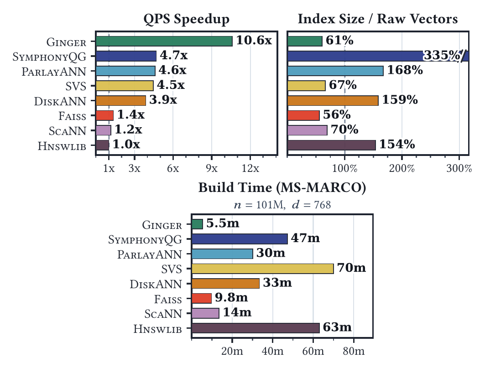

# GINGER — Graph Indices for Generalized Entity Retrieval

Ginger is a C++ library for approximate nearest neighbor (ANN) retrieval using
graph-structured indices. It delivers state-of-the-art performance on dense
single-vector embeddings using dot product or squared L2 distance, and also supports
arbitrary distance functions (BYOD). See the [Ginger paper](https://arxiv.org/abs/2611.08306) for details
and benchmarks.

<p align="center">
  
</p>

*Query throughput relative to Hnswlib at 95% 10@10 recall (top left, higher is
better) and memory footprint (graph and compressed vectors) relative to raw
vectors (top right, lower is better) as the geometric mean across 14 datasets,
alongside index construction time on MS-MARCO (bottom, lower is better). See
the paper for details and the full experimental results.*

## Why use Ginger?

-   **Extremely fast index builds with PiPNN:** The [PiPNN](https://dl.acm.org/doi/10.1145/3770855.3817891)
    graph construction algorithm builds indices an order of magnitude faster than Vamana
    and other well-known libraries (such as DiskANN and HNSW), while achieving equivalent
    QPS-recall search performance.
-   **Approximate kNN graphs:** PiPNN can also build approximate kNN graphs
    directly (see [kNN Graph Construction](#knn-graph-construction)).
-   **High retrieval quality at scale:** Delivers state-of-the-art recall and speed on
    dense single-vector embeddings, scaling up to a billion vectors in memory on a single
    machine.
-   **Extreme compression without speed loss:** Integrating graph indices with
    [TurboQuant](https://arxiv.org/abs/2504.19874) 4-bit quantization enables extremely
    fast distance computations. Rerank with either floats or 1–8 additional bits of
    precision.
-   **Flexible similarity functions:** Easily extensible to custom distance metrics,
    currently providing native support for MIPS (dot product) and squared L2 distance.

## Quick Start

The easiest way to get a good index is to start from the recommended
configuration:

```cpp
#include <memory>
#include <vector>

#include "absl/status/status_macros.h"
#include "ginger/ginger.h"

// vectors[i] and query are float vectors of length dim.
auto dataset = std::make_shared<ginger::SpanDataset>(num_points, dim);
for (int i = 0; i < num_points; ++i) dataset->Set<float>(i, vectors[i]);

ABSL_ASSIGN_OR_RETURN(
    ginger::GingerSearcherConfig config,
    ginger::RecommendGingerConfig(dim, ginger::SQUARED_L2,
                                  /*robust_prune_alpha=*/1.08f));
ABSL_ASSIGN_OR_RETURN(
    std::unique_ptr<ginger::GingerSearcher> searcher,
    ginger::GingerSearcherBuilder(config).AddDataset(dataset).Build());

// The 10 nearest neighbors, sorted by distance (lower = more similar).
// Increase beam_size for higher recall at the cost of latency.
ABSL_ASSIGN_OR_RETURN(
    std::vector<ginger::DistanceAndId> neighbors,
    searcher->FindNeighbors(query, searcher->DefaultSearchOptions(
                                       /*num_neighbors=*/10, /*beam_size=*/64)));
```

## Building & Installing

Ginger supports both **CMake** and **Bazel** (Bzlmod) builds.

### Prerequisites

-   A C++20-compatible compiler (GCC 13+ or Clang 17+). When building against
    libc++, libc++ 19+ is required.
-   Git (used to fetch dependencies when building from source)
-   **CMake 3.24+** (for CMake builds) or **Bazel 8+** (for Bazel builds). Bazel
    builds also need `cmake` and `make` installed, because the KaMinPar
    dependency is built with CMake.

For the best performance, link [jemalloc](https://jemalloc.net/) into your
binaries, as the paper's benchmarks do. In CMake, pass
`-DGINGER_USE_JEMALLOC=ON` (this needs the jemalloc development package, e.g.
`libjemalloc-dev`). In Bazel, build with `--config=jemalloc`. In your own Bazel
project, add `jemalloc` to your `MODULE.bazel` and set `--custom_malloc` to it
instead (with `-fno-exceptions`, also copy the `-fexceptions` exemption from
Ginger's `.bazelrc`).

### Building with CMake

Configure and build the library, unit tests, and example binaries:

```bash
cmake -B build -DCMAKE_BUILD_TYPE=Release
cmake --build build -j
```

Run the unit test suite via CTest:

```bash
ctest --test-dir build --output-on-failure -j
```

Run the example binaries:

```bash
./build/ginger_example
./build/ginger_byod_example
./build/pipnn_knn_example
```

To use system-installed dependencies instead of fetching them, pass
`-DGINGER_USE_SYSTEM_DEPS=ON`. The [build guide](ginger/docs/compiling.md) lists all
CMake options and shows how to add Ginger to your own CMake
project.

### Building with Bazel

Build all targets and run unit tests using Bazel. Always pass `-c opt`; the
default `fastbuild` mode builds without optimizations and is far slower.

```bash
bazel build -c opt //...
bazel test -c opt //...
```

Run the examples with Bazel:

```bash
bazel run -c opt //ginger/examples:ginger_example
bazel run -c opt //ginger/examples:ginger_byod_example
bazel run -c opt //ginger/examples:pipnn_knn_example
```

The [build guide](ginger/docs/compiling.md) also shows how to add Ginger as a Bzlmod
dependency.

## Usage

### The recommended configuration

The Quick Start above builds the index from the recommended configuration,
which picks the graph algorithm, quantization and compression for you. These
choices may change between releases. The recommended configuration supports
float datasets only. The [tuning guide](ginger/docs/tuning.md) explains each choice and
how to change it.

A few things to know:

-   Datasets can hold `float`, `int8_t`, or `uint8_t` coordinates.
-   Index construction runs in parallel on all cores. To use fewer threads, set
    the `PARLAY_NUM_THREADS` environment variable.
-   `FindNeighbors` is `const` and thread-safe, so multiple threads can query
    the same searcher concurrently.

### Custom configuration

To control each part yourself, write the configuration directly. This example
builds a PiPNN graph, reorders and compresses it, and reranks with 2 extra
TurboQuant bits per dimension:

```cpp
#include "google/protobuf/text_format.h"
#include "ginger/ginger.h"

ginger::GingerSearcherConfig config;
google::protobuf::TextFormat::ParseFromString(R"pb(
  distance_metric: SQUARED_L2
  pipnn_config {
    max_degree: 64
    prune_config { alpha: 1.15 }
    leader_selection { fanout_sequence: [ 10, 3 ] }
  }
  use_graph_compression: true
  reordering_algorithm: RECURSIVE_GRAPH_PARTITIONING
  turbo_quant { seed: 42 extra_bits: 2 }  # 4+2 = 6 bits/dim
)pb", &config);

ABSL_ASSIGN_OR_RETURN(
    std::unique_ptr<ginger::GingerSearcher> searcher,
    ginger::GingerSearcherBuilder(config).AddDataset(dataset).Build());

ginger::SearchOptions options;
google::protobuf::TextFormat::ParseFromString(R"pb(
  search_space: SEARCH_SPACE_TURBO_QUANT
  reranking_strategy: RERANKING_STRATEGY_TURBO_QUANT_EXTRA_BITS
  beam_size: 64
  num_neighbors: 10
)pb", &options);

ABSL_ASSIGN_OR_RETURN(std::vector<ginger::DistanceAndId> results,
                      searcher->FindNeighbors(query, options));
```

To build a Vamana graph instead, set `vamana_config` in place of
`pipnn_config`. See [`pipnn/config.proto`](ginger/pipnn/config.proto) and
[`vamana/config.proto`](ginger/vamana/config.proto) for all options.

### Saving and loading

[`ginger/io/io.h`](ginger/io/io.h) stores each index in a single file:

```cpp
#include "ginger/io/io.h"

// The parent directory ("/path/to/dir") must already exist.
const std::string path = "/path/to/dir/my_index";
ABSL_RETURN_IF_ERROR(ginger::io::SaveGingerSearcher(*searcher, path));

ABSL_ASSIGN_OR_RETURN(std::unique_ptr<ginger::GingerSearcher> loaded_searcher,
                      ginger::io::LoadGingerSearcher(path));
```

To save the index without its dataset and attach your existing dataset at load
time, see the [serialization guide](ginger/docs/serialization.md).

### Examples

-   [`ginger_example`](ginger/examples/ginger_example.cc): Builds a `GingerSearcher` over synthetic vectors and runs
    nearest-neighbor queries.
-   [`ginger_byod_example`](ginger/examples/ginger_byod_example.cc): Builds a Vamana index and runs beam search with a
    custom distance callback.
-   [`pipnn_knn_example`](ginger/examples/pipnn_knn_example.cc): Builds an approximate k-NN graph with PiPNN, without a
    search index.

## Features

### TurboQuant

Compresses float vectors to **4 bits/dim** for extremely fast distance computations;
decodes on-the-fly using in-register table lookups and fast dot product instructions
(e.g., VNNI's `vpdpbusd`).

-   **Extra precision (4+k):** 1, 2, 3, 4, 6, or 8 additional bits per dimension
    for higher-accuracy reranking. Disaggregated storage retains 4-bit scoring
    speed.
-   **TurboSlice:** Score a prefix of dimensions for even faster pruning, then
    full-length distance computation on survivors. Enable via
    `turbo_quant.set_turboslice_dimensionality(...)`.

### PCA Projection (optional)

Reduces dimensionality before TurboQuant quantization to save memory and speed up
search. Configure via `config.mutable_pca()`.

-   Fixed target dimension, or variance-based truncation (e.g., preserve 90% variance).
-   Projection matrix can be stored as float32 or quantized with TurboQuant.

### Index Graph Construction

Two algorithms for building the search graph:

-   **PiPNN** ([paper](https://dl.acm.org/doi/10.1145/3770855.3817891)): Recursive partitioning →
    leaf kNN graphs → HashPrune + RobustPrune. Extremely fast build (significantly
    faster than Vamana and HNSW) with equivalent QPS-recall search performance to
    Vamana. Recommended for fast index construction.
-   **Vamana** ([DiskANN](https://papers.nips.cc/paper_files/paper/2019/file/09853c7fb1d3f8ee67a61b6bf4a7f8e6-Paper.pdf),
    [ParlayANN](https://dl.acm.org/doi/10.1145/3627535.3638475)): Incremental
    batch-insert with beam search + RobustPrune.

The [index construction guide](ginger/docs/index_construction.md) explains the
parameters of both.

### kNN Graph Construction

`BuildPipnnKnnGraph` ([`pipnn/pipnn_knn.h`](ginger/pipnn/pipnn_knn.h)) builds an approximate directed kNN
graph with PiPNN's partitioning, without building a search index. This is
useful for clustering, graph mining, or as input to other graph algorithms.
Candidates are scored on 4-bit TurboQuant codes and can be reranked with float
or extra-bit distances. See the [`pipnn_knn_example`](ginger/examples/pipnn_knn_example.cc) binary.

### Graph Storage

-   **FlatGraph:** Contiguous degree+neighbors per node. Cache-friendly.
-   **CompressedCSRGraph:** Stores each sorted neighbor list as variable-length
    encoded gaps with the SIMD-decoded AdaptiveGap codec. Best for memory
    footprint. Enable with `config.set_use_graph_compression(true)`, together
    with a node reordering (`config.set_reordering_algorithm(...)`) to shrink
    the gaps.

The [graph storage guide](ginger/docs/graph_storage.md) compares the formats, reordering algorithms, and codecs.

### Search

`GingerSearcher::FindNeighbors` supports multi-stage retrieval: graph traversal
over TurboQuant codes or raw vectors, followed by optional reranking with floats
or extra TurboQuant bits. All search parameters are set in `SearchOptions` (see
[`searcher.proto`](ginger/searcher.proto)). Tune `beam_size` to trade latency for
recall. The [search guide](ginger/docs/search.md) covers each option.

### Distance Metrics

<!-- mdformat off -->
Metric      | Enum          | Notes
----------- | ------------- | -----------------------------
Dot product | `DOT_PRODUCT` | Negative dot product used as distance. Lower = more similar.
Squared L2  | `SQUARED_L2`  | Recommended for unit-normalized data.
<!-- mdformat on -->

There is no default metric: `Build()` returns an error if `distance_metric` is
not set.

### Bring Your Own Distance (BYOD)

For distance functions not built into `GingerSearcher`, you can use the lower-level
`BuildVamanaIndex` and `NavigationBeamSearch` APIs directly. Both accept a
`compute_distances` callback that you implement with any distance logic. Set
`nonpositive_distances` in the prune config to match the sign of your
distances: true for distances `<= 0` (e.g., negative dot product), false for
`>= 0`. See the [`ginger_byod_example`](ginger/examples/ginger_byod_example.cc) binary for a
complete runnable example.

### Not yet supported

-   Index updates
-   Filtered search
-   Multi-vector search

## Documentation

-   [Tuning guide](ginger/docs/tuning.md)
-   [Index construction](ginger/docs/index_construction.md)
-   [Search](ginger/docs/search.md)
-   [Graph storage](ginger/docs/graph_storage.md)
-   [Saving and loading](ginger/docs/serialization.md)
-   [Compiling](ginger/docs/compiling.md)

## References

-   Ginger: [arXiv](https://arxiv.org/abs/2611.08306)
-   TurboQuant: [ICLR '26](https://openreview.net/pdf?id=tO3ASKZlok) /
    [arXiv](https://arxiv.org/abs/2504.19874)
-   PiPNN: [KDD '26](https://dl.acm.org/doi/10.1145/3770855.3817891)
-   ParlayANN: [PPoPP '24](https://dl.acm.org/doi/10.1145/3627535.3638475)
-   Vamana / DiskANN: [NeurIPS '19](https://papers.nips.cc/paper_files/paper/2019/file/09853c7fb1d3f8ee67a61b6bf4a7f8e6-Paper.pdf)
-   Recursive Graph Partitioning (KaMinPar):
    [ESA '21](https://doi.org/10.4230/LIPIcs.ESA.2021.48)
-   Recursive Graph Bisection:
    [KDD '16](https://dl.acm.org/doi/10.1145/2939672.2939862)

If you use Ginger in your research, please cite:

```text
@article{salwasser2026ginger,
  title   = {{GINGER}: Spicing Up Graph-Based Vector Search},
  author  = {Salwasser, Daniel and Gottesb{\"u}ren, Lars and Dhulipala, Laxman and {\L}{\k{a}}cki, Jakub and Blelloch, Guy and Jayaram, Rajesh and Rubel, Tobias and Sheth, Kshiteej and Zandieh, Amir and Mirrokni, Vahab},
  journal = {arXiv preprint arXiv:2611.08306},
  year    = {2026}
}
```

## License

Apache 2.0, see [LICENSE](LICENSE). See [CONTRIBUTING](CONTRIBUTING.md) and
[SECURITY.md](SECURITY.md) for contributions and security reports.

This is not an officially supported Google product.
